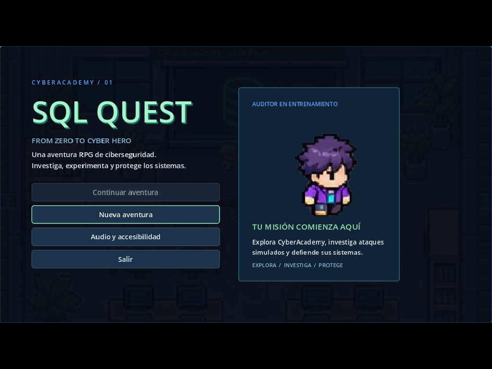
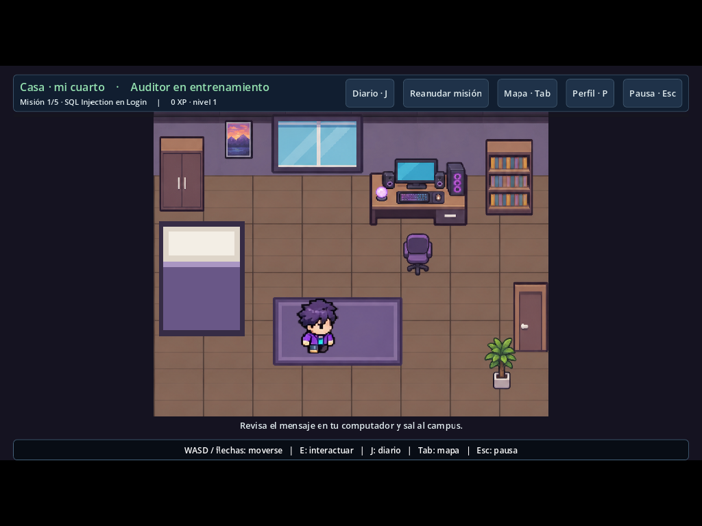
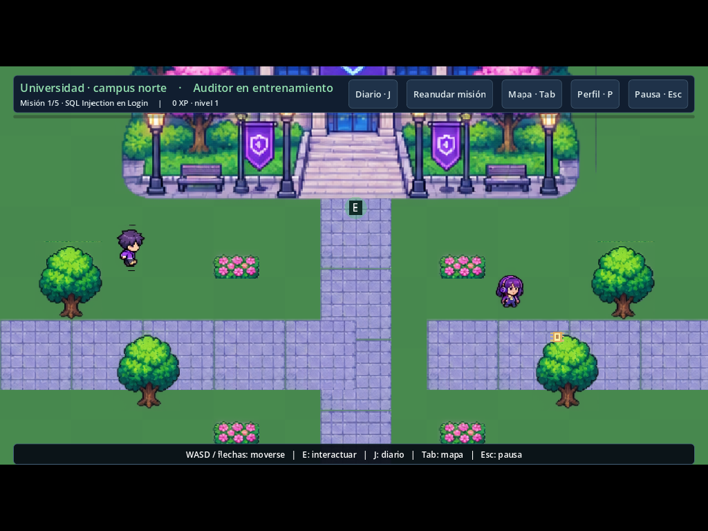
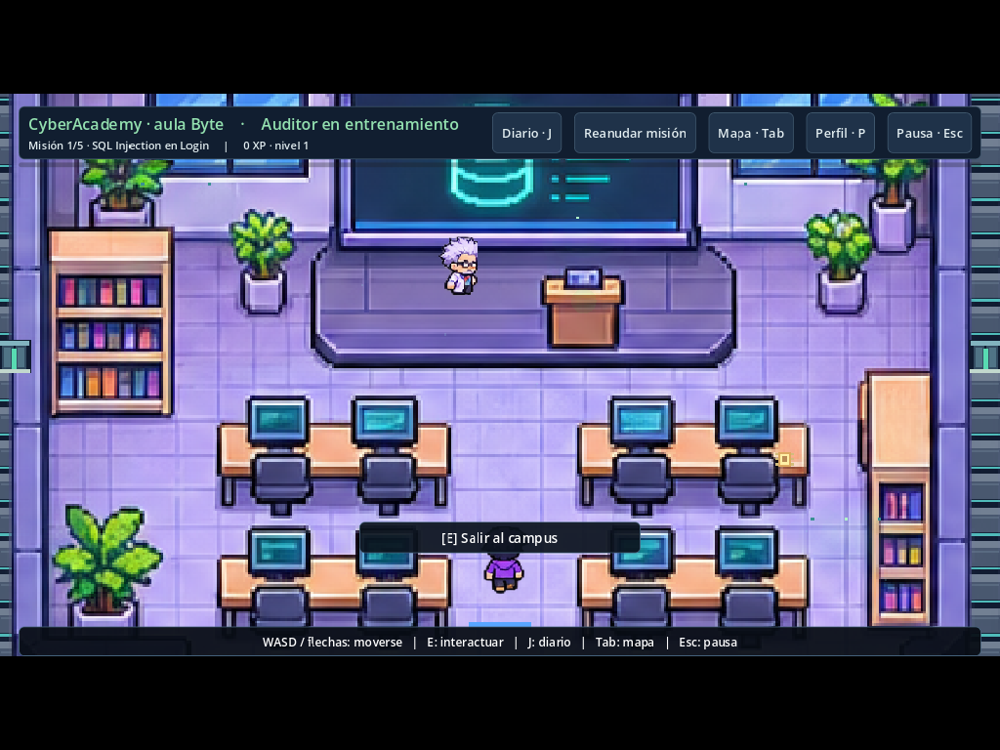
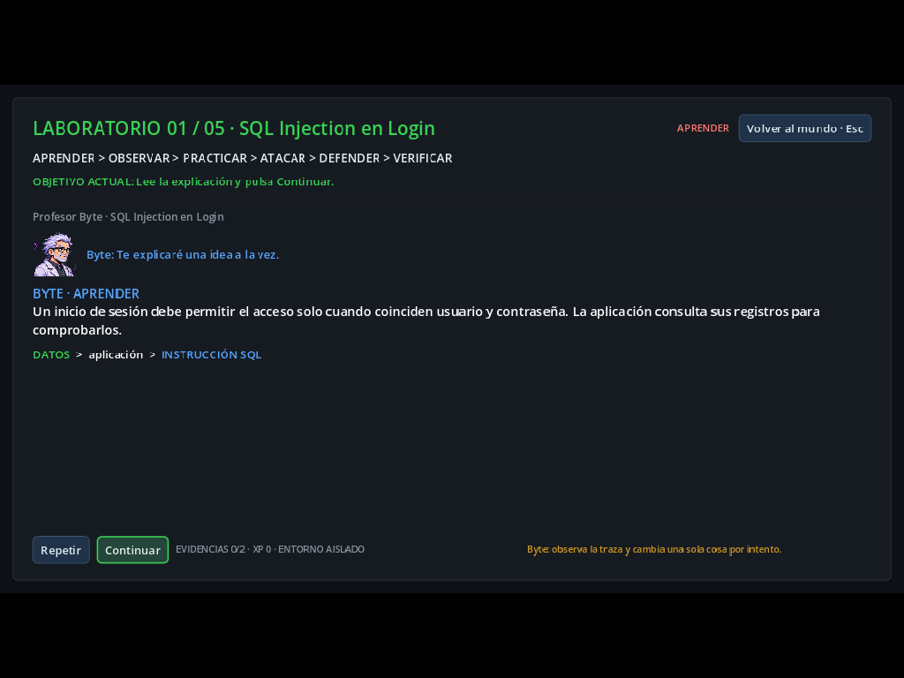

# SQL QUEST: From Zero to Cyber Hero

*Videojuego RPG 2D educativo sobre inyección SQL, demostración de vulnerabilidades y programación segura.*


**Jugar en línea:** publicación pendiente · **[Código fuente](https://github.com/VoidxGongy/sql-quest-from-zero-to-cyber-hero)**

## El videojuego

SQL Quest es una aventura educativa desarrollada con Godot 4. El jugador explora CyberAcademy, conversa con el Profesor Byte y participa en laboratorios simulados para comprender y corregir vulnerabilidades de **SQL Injection**. El nombre técnico configurado actualmente en el proyecto es *SQL Quest: CyberGuard · SQL Injection RPG*.

La aventura comienza en la habitación del protagonista. Tras recibir un mensaje de CyberAcademy, sale al campus y visita el aula de Byte. La formación continúa en laboratorios y termina con un incidente de ataque y defensa frente al equipo ficticio NullSec. El mundo incluye personajes, diálogos, colisiones, terminales, zonas bloqueadas y desbloqueos.

## Objetivo y metodología

El juego se centra en la inyección SQL y su prevención, no en enseñar SQL general. El objetivo es reconocer cómo los datos no confiables pueden alterar una consulta, analizar las consecuencias y aplicar defensas apropiadas.

**Aprender → Observar → Practicar → Atacar → Defender → Verificar.**

Byte introduce cada concepto y guía las prácticas. El jugador experimenta con entradas manipuladas en un simulador con datos ficticios, examina la consulta y sus efectos, y construye la corrección con bloques de código. Después comprueba el parche con casos legítimos y manipulados. Las misiones otorgan experiencia y desbloquean nuevos desafíos.

## Cinco misiones

| Nivel | Incidente | Aprendizaje y defensa |
|---|---|---|
| 01 | SQL Injection en login | Alteración de autenticación y consultas parametrizadas. |
| 02 | UNION-based SQL Injection | Exposición de datos sintéticos en una búsqueda y `LIKE` parametrizado. |
| 03 | SQL Injection en `ORDER BY` | Manipulación de identificadores y selección mediante lista blanca. |
| 04 | Blind SQL Injection | Interpretación de respuestas booleanas y latencia virtual; parámetros y autorización. |
| 05 | Incidente final NullSec | Demostración de login, UNION y `ORDER BY`, defensa integral, pruebas y reporte. |

La campaña conserva evidencias, puntuación, parches y desbloqueos. En el incidente final se documentan la evidencia, la causa y la corrección.

## Tecnologías

| Tecnología | Uso |
|---|---|
| Godot Engine 4 | Motor y ejecución del juego 2D. |
| GDScript | Mundo, personajes, interfaces, campaña y simulador. |
| Pixel art | Recursos visuales para escenarios y personajes. |
| HTML5 / WebAssembly | Exportación para navegadores. |
| Git y GitHub | Control de versiones y repositorio. |

## Inteligencia artificial generativa utilizada

Las herramientas de IA apoyaron el desarrollo; las decisiones académicas, la selección de contenido, la revisión y la validación corresponden al equipo.

### ChatGPT — OpenAI

Se utilizó como apoyo para la conceptualización del juego, el diseño de niveles y la estructuración del aprendizaje de SQL Injection; también para elaborar prompts de desarrollo, proponer interfaces y mecánicas, generar recursos gráficos pixel art, analizar errores visuales a partir de capturas y apoyar la documentación académica.

### Codex — OpenAI

Se utilizó para apoyar la generación y modificación de GDScript, la implementación de escenas, misiones y laboratorios, la corrección de errores, los ajustes de colisiones, animaciones e interfaces, y la preparación de la exportación Web.

### GitHub Copilot

GitHub Copilot se utilizó como asistente de programación para apoyar la escritura y revisión de código, proponer soluciones y colaborar en la detección y corrección de errores durante el desarrollo del videojuego. Las sugerencias generadas fueron revisadas y adaptadas por el equipo.

## Capturas del videojuego

### Menú principal



### Habitación inicial



### Campus universitario



### Aula del Profesor Byte



### Laboratorio de SQL Injection



La captura de la actividad de remediación está pendiente.

## Controles

| Tecla | Acción |
|---|---|
| WASD / flechas | Mover al personaje. |
| E | Interactuar y avanzar diálogos. |
| Espacio / Enter | Avanzar diálogos. |
| J | Diario de misiones. |
| Tab | Mapa. |
| P | Perfil. |
| I | Inventario. |
| K | Conocimientos. |
| Esc | Pausar, cerrar paneles o cerrar el laboratorio. |

En el laboratorio se pueden seleccionar y organizar bloques con el ratón. También existen controles de movimiento en pantalla para dispositivos táctiles; consulta las limitaciones de validación en [INFORME_VERIFICACION.md](INFORME_VERIFICACION.md).

## Ejecutar desde el código fuente

Se requiere Godot 4.7.x o una versión 4.x compatible. No se necesitan plugins, servidor, Python ni una base de datos externa para ejecutar el proyecto en Godot.

```bash
git clone https://github.com/VoidxGongy/sql-quest-from-zero-to-cyber-hero.git
cd sql-quest-from-zero-to-cyber-hero
godot --path .
```

También puedes importar `project.godot` en Godot y ejecutar el proyecto con F5. La escena principal es `scenes/main.tscn`.

## Exportación Web

El preset `Web` de `export_presets.cfg` usa el renderizador Compatibility y desactiva los hilos. Instala las plantillas de exportación compatibles con tu versión de Godot y ejecuta:

```bash
godot --headless --path . --export-release "Web" build/web/index.html
python3 -m http.server 8080 --directory build/web
```

Abre `http://127.0.0.1:8080/`. El segundo comando requiere Python y sirve la exportación por HTTP; no abras el juego directamente mediante `file://`. Regenera `build/web/` cuando cambien el código o la versión de Godot. El repositorio incluye archivos exportados, pero no se ha identificado una publicación pública verificable.

Para publicar de forma estática, se puede subir el contenido de `build/web/` a Netlify, Cloudflare Pages o GitHub Pages. Mantén juntos `index.html`, los archivos `.wasm`, `.pck`, `.js` y los worklets de audio.

## Arquitectura

- `scenes/main.tscn`: escena raíz.
- `scripts/game.gd`: mundo, HUD, diálogos, interacción, transiciones y apertura del laboratorio.
- `scripts/player/hero.gd`: movimiento y animación del protagonista.
- `scripts/world/academy.gd`: salas, personajes, terminales y zonas desbloqueables.
- `scripts/missions/campaign.gd` y `data/missions/campaign.json`: progresión y contenido de las misiones.
- `scripts/missions/code_blocks.gd` y `scripts/ui/quest_lab.gd`: bloques de defensa e interfaz del laboratorio.
- `scripts/sql_simulator/query_engine.gd`: simulación acotada en memoria con datos ficticios.
- `assets/`: recursos visuales y de sonido; `tests/`: pruebas del simulador, la campaña y el flujo RPG.

## Seguridad y límites de la simulación

Los ataques se representan en un entorno ficticio: el juego no ejecuta SQL externo, no evalúa el Python mostrado y no contiene datos reales. El evaluador reconoce bloques predefinidos y sus dependencias; no verifica programas arbitrarios. La latencia del nivel blind es virtual.

En sistemas reales, las consultas parametrizadas deben acompañarse de autorización, mínimo privilegio, gestión de secretos, registro seguro y almacenamiento seguro de contraseñas mediante algoritmos de hashing apropiados. Los identificadores dinámicos se seleccionan desde una lista permitida del servidor, en lugar de tratarlos como valores parametrizados.

## Verificación

Para ejecutar la suite local:

```bash
GODOT_BIN=godot tests/run_tests.sh
```

[INFORME_VERIFICACION.md](INFORME_VERIFICACION.md) documenta resultados anteriores, comprobaciones de la exportación y limitaciones pendientes. Una carga inicial del canvas no demuestra el funcionamiento completo en todos los navegadores ni sustituye pruebas con jugadores.

## Equipo y créditos

Proyecto académico de Ingeniería de Sistemas de la **Universidad Libre — Seccional Barranquilla**. Año: 2026. Integrantes, asignatura y docente: pendientes de incorporar.

Desarrollo y diseño académico: equipo de SQL Quest. Motor: Godot Engine. Asistencia de IA: ChatGPT y Codex de OpenAI, y GitHub Copilot. Recursos gráficos: assets del proyecto y recursos generados con apoyo de IA, revisados e integrados por el equipo. Consulta las licencias correspondientes a los recursos utilizados. Los prompts para futuras versiones visuales están en [PROMPTS_AVATARES.md](PROMPTS_AVATARES.md).

---

**SQL QUEST — Aprende cómo funciona el ataque. Descubre la vulnerabilidad. Construye la defensa.**
